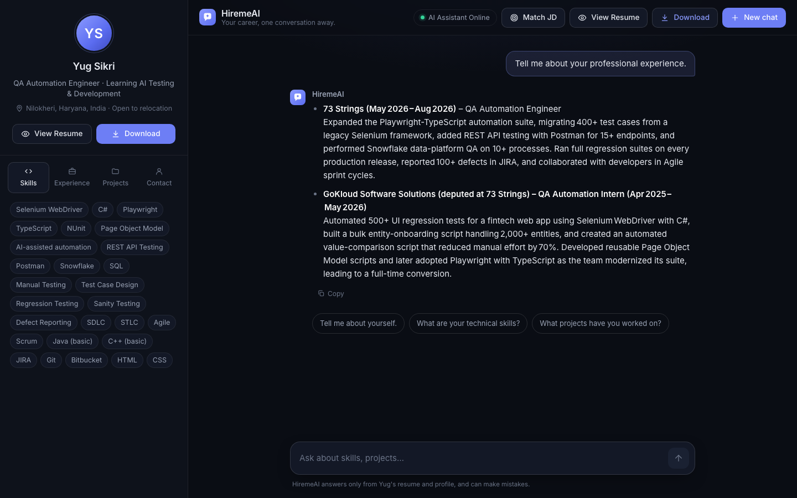
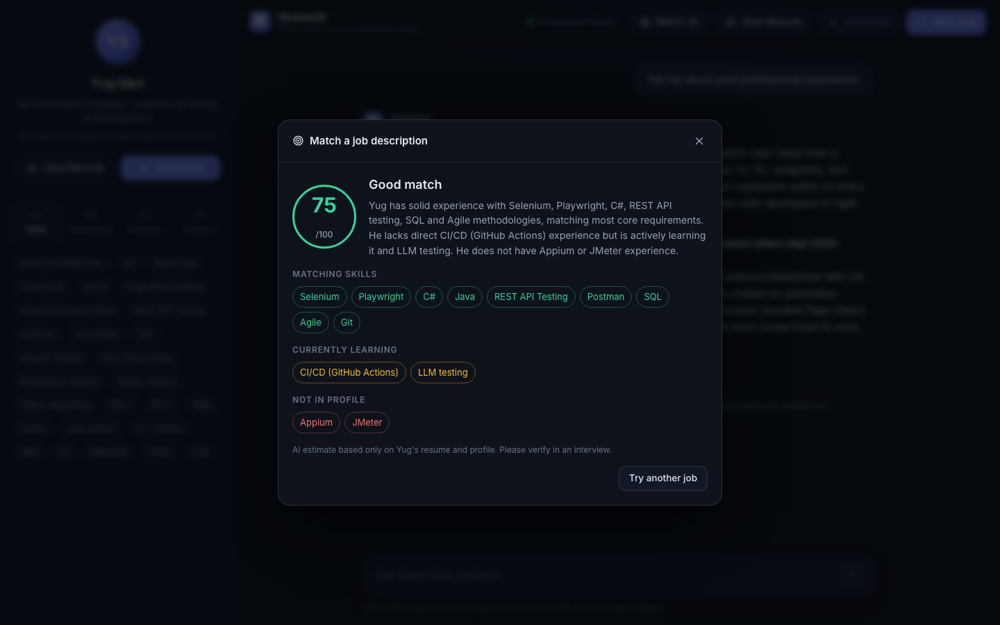
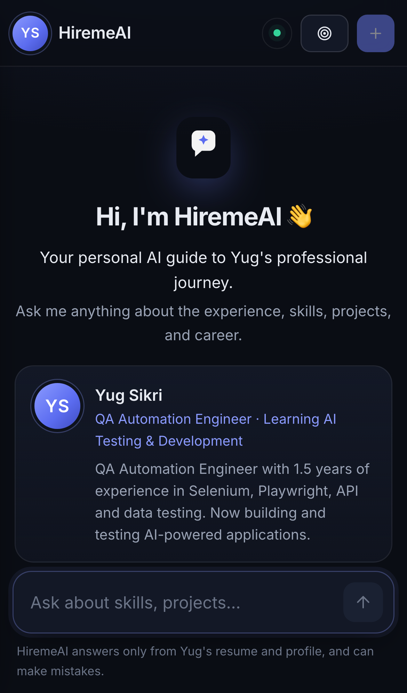

# HiremeAI 🤖

**Your career, one conversation away.**

A personal AI career assistant: recruiters chat with an AI that answers questions about Yug Sikri
using **only** his real resume and profile — no invented experience.

**🔗 Live:** https://hiremeai-yugsikri.vercel.app

[](https://github.com/Yugsikri2004/hiremeai/actions/workflows/ci.yml)



## Features
- **Chat with the candidate's AI** — streaming answers, remembers the conversation, suggested + follow-up questions.
- **JD Matcher** — paste a job description, get a match score with matching, currently-learning and missing skills.
- **Profile sidebar** — skills, experience, projects, contact; view / download the resume.
- **Honest by design** — answers only from the resume + profile; says "I don't know" instead of guessing; resists prompt injection.
- **Mobile friendly** — the sidebar becomes a drawer.

| JD Matcher | Mobile |
|---|---|
|  |  |

## Tech stack
| Part | Tech |
|---|---|
| Backend | Python, FastAPI, Groq (`openai/gpt-oss-120b`), Pydantic, streaming responses |
| Frontend | React (Vite), plain CSS (dark theme), react-markdown |
| Testing | pytest (backend, LLM mocked), Playwright E2E (desktop + mobile, backend mocked) |
| CI / Deploy | GitHub Actions, Render (backend), Vercel (frontend) |

## Folder structure
```
hiremeai/
├── backend/
│   ├── main.py              ← FastAPI app (/, /profile, /resume, /chat, /match)
│   ├── tests/               ← pytest API tests (Groq mocked, no API key needed)
│   ├── Yug.pdf              ← resume (replace this file to update the resume)
│   └── data/
│       ├── resume.json      ← auto-generated from Yug.pdf (cache)
│       ├── extra_info.md    ← info beyond the resume (goals, availability, ...)
│       └── profile_card.json← sidebar info (headline, location, LinkedIn, GitHub)
└── frontend/
    └── src/
        ├── api/client.js    ← all backend calls (no API keys here)
        ├── hooks/           ← useChat (chat logic), useProfile (profile + status)
        ├── components/      ← Sidebar, ChatHeader, WelcomeScreen, MessageList, ChatInput, ResumeModal
        └── data/questions.js← suggested + follow-up questions
    └── tests/e2e/           ← Playwright E2E tests (backend mocked)
```

## Run locally
Needs `GROQ_API_KEY` in a `.env` file (backend folder or a parent folder).

Backend (from `hiremeai/`):
```bash
uv run uvicorn main:app --app-dir backend --reload
```

Frontend (from `hiremeai/frontend/`):
```bash
npm install
npm run dev
```
Open http://localhost:5173

## Run tests
Backend (from `hiremeai/`):
```bash
uv run pytest backend/tests -v
```

Frontend E2E (from `hiremeai/frontend/`, first time: `npx playwright install chromium`):
```bash
npm run test:e2e
```

Both run automatically on every push (GitHub Actions → `CI`).

## Updating the content
- **New resume:** replace `backend/Yug.pdf` and restart the backend — it re-parses automatically.
- **Extra info / headline / links:** edit the files in `backend/data/` and restart the backend.

## Security
- Groq API key stays in the backend `.env` only (never in frontend code).
- Input validation (message length, history size, roles) with Pydantic.
- Basic rate limit: 15 chat requests per minute per IP.
- No public upload endpoint — the resume can only be changed by replacing the file on the server.

## Deployment
- Backend: Render (free) — root `backend`, env `GROQ_API_KEY`, `FRONTEND_URL`.
- Frontend: Vercel (free) — root `frontend`, env `VITE_API_URL`.
- Every push to `main` redeploys both. A scheduled GitHub Action (`keep-awake.yml`) pings the backend
  every 10 min so the free Render server doesn't sleep.
